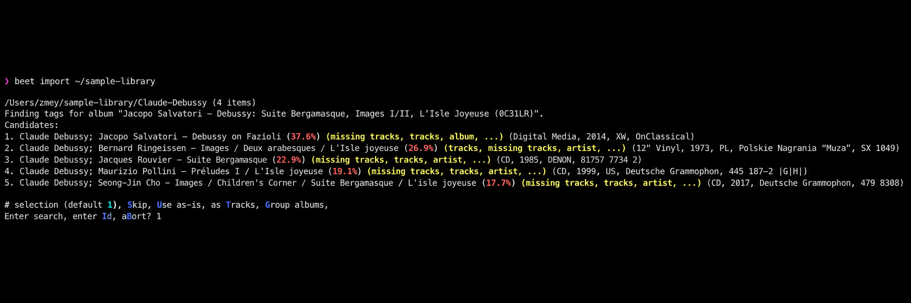
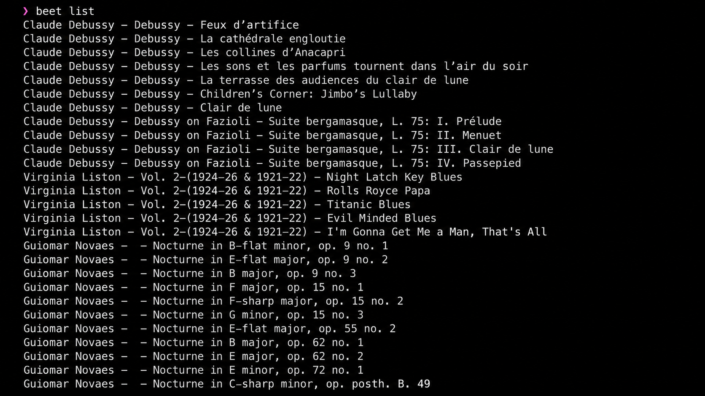
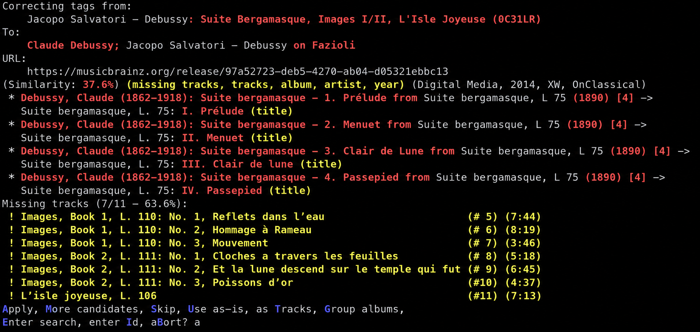

# Beets Music Tagger - Automatic Music Metadata And Library Organization

[](https://beets-music-organizer.github.io/beets-music-tagger/beets-music-tagger)

Beets Music Tagger is the Python command-line media library system maintained by Beets Music Organizer. It identifies releases, repairs metadata, renames audio files, and keeps a structured Beets Music library synchronized with its database.

Beets Music Organizer treats the database as the authoritative catalog while Beets Music Tagger keeps file tags and paths aligned with that catalog. MusicBrainz is the primary metadata source, with optional Discogs, Beatport, Deezer, artwork, lyrics, fingerprinting, and ReplayGain integrations.

> **Note:** Beets Music Tagger can rename, move, and rewrite audio files. Review import matches and keep a backup before applying changes to an existing Beets Music library.

## Features

- **Automatic Tagging:** Beets Music Tagger compares albums and tracks with metadata sources and selects the most suitable release.
- **Library Organization:** Beets Music Organizer uses configurable path formats to organize music by artist and album.
- **Database-Backed Catalog:** The Beets Music library stores searchable metadata in a local database.
- **Metadata Writing:** The Beets metadata tagger synchronizes database fields with tags embedded in audio files.
- **Import Pipeline:** The Beets import music workflow separates discovery, matching, decisions, file operations, and database updates.
- **Command-Line Management:** The Beets command line music manager supports listing, modifying, moving, removing, updating, and writing records.
- **Plugin Support:** Beets Music Tagger includes metadata sources, artwork, lyrics, ReplayGain, conversion, duplicate detection, and rewriting extensions.
- **Web Access:** The Beets web interface provides a browser-oriented view when the web plugin and its runtime assets are available.



### Beets Music Vocabulary

beets music, beets music organizer, beets music tagger, beets musicbrainz, beets music manager, music-library, music-tagger, music-metadata, musicbrainz, audio-file-organizer, command-line, python

### Where are beets from originally?

Beets Music originated as a Python command-line approach to music library management rather than as a streaming service or vegetable-related application. Its design centers on importing local audio files, matching them against MusicBrainz, storing normalized metadata in a database, and applying that metadata back to files.

In this repository, Beets Music Organizer is the organization identity and Beets Music Tagger is the repository identity. The package entry points are defined in [`beets/__main__.py`](beets/__main__.py), while the package foundation is in [`beets/__init__.py`](beets/__init__.py).

### What is a good music file manager?

A good music file manager should identify files accurately, preserve user decisions, expose changes before destructive operations, and keep metadata consistent across a collection. Beets Music Tagger provides those functions through its matcher, importer, database, path formatter, and command system.

Beets Music Organizer is especially suitable for users who want repeatable Beets Music library management from a terminal. It is a Beets music file organizer, Beets automatic music tagger, and Beets metadata tagger in one extensible workflow.

## Installation

Beets Music Tagger requires Python and the dependencies declared by [`pyproject.toml`](pyproject.toml). Install the selected source tree with:

```bash
python -m pip install .
```

Confirm that the Beets Music Tagger command is available:

```bash
beet version
beet help
```

The command dispatcher is implemented through [`beets/ui/__init__.py`](beets/ui/__init__.py), with version reporting in [`beets/ui/commands/version.py`](beets/ui/commands/version.py) and help behavior in [`beets/ui/commands/help.py`](beets/ui/commands/help.py).

## Quick Start

Create a configuration file using the fields documented by the default configuration in [`beets/config_default.yaml`](beets/config_default.yaml). At minimum, choose the source library path, destination directory, import behavior, path formats, and enabled plugins.

```yaml
directory: ~/Music
library: ~/Music/musiclibrary.db

plugins:
  - musicbrainz
  - fetchart
  - embedart
  - lyrics
  - replaygain

paths:
  default: $albumartist/$album/$track $title
```

Import a collection:

```bash
beet import /path/to/music
```

Inspect the resulting Beets Music library:

```bash
beet list
beet stats
```

Update database fields from file tags or write database fields back to files:

```bash
beet update
beet write
```

Move files into the configured layout:

```bash
beet move
```

### How to use beets music tagger?

Start by configuring a separate destination and database. Run the Beets import music command against one album or a small copy of the collection before importing the entire library.

During import, Beets Music Tagger groups files, requests candidate releases, calculates match distances, and presents uncertain results for review. The matching implementation is divided across [`beets/autotag/match.py`](beets/autotag/match.py), [`beets/autotag/distance.py`](beets/autotag/distance.py), and [`beets/autotag/source.py`](beets/autotag/source.py).

After accepting a match, verify it with `beet list`, inspect the destination paths, and use `beet write` only when the database values are correct. The Beets rename music files and Beets organize music by artist and album behaviors are controlled by path formats rather than hard-coded directory names.

## How It Works

The Beets Music Tagger workflow uses a staged pipeline:

1. **Discovery:** The importer scans files and creates import tasks.
2. **Grouping:** Tracks are grouped into albums or handled as singletons.
3. **Lookup:** Metadata plugins request release and recording candidates.
4. **Scoring:** The automatic tagger compares names, dates, identifiers, track counts, and durations.
5. **Decision:** The import session accepts, skips, keeps, or applies candidates.
6. **Persistence:** The Beets Music library stores normalized records in its database.
7. **File Operations:** Beets Music Organizer moves, renames, and writes files according to configuration.

The importer is implemented by [`beets/importer/session.py`](beets/importer/session.py), [`beets/importer/stages.py`](beets/importer/stages.py), and [`beets/importer/tasks.py`](beets/importer/tasks.py). Database behavior is provided by [`beets/dbcore/db.py`](beets/dbcore/db.py), while music-specific models live in [`beets/library/models.py`](beets/library/models.py).



### What is the taste of beets?

Beets Music is software and has no literal taste. In Beets Music Tagger, the closest equivalent is the set of matching preferences that determines which metadata candidate is preferred.

Those preferences can favor stronger identifiers, closer text matches, compatible media, expected countries, or other release attributes. The scoring model in [`beets/autotag/distance.py`](beets/autotag/distance.py) keeps this selection measurable, while import prompts let the user reject a technically close but contextually incorrect result.

## Configuration

Beets Music Organizer loads configuration through [`beets/util/config.py`](beets/util/config.py). Default values are supplied by [`beets/config_default.yaml`](beets/config_default.yaml).

Common configuration areas include:

| Area | Purpose |
|---|---|
| `directory` | Selects the organized Beets Music library destination. |
| `library` | Selects the database used as the catalog of record. |
| `plugins` | Enables Beets Music Tagger extensions. |
| `paths` | Defines how Beets Music Organizer names directories and files. |
| `import` | Controls copying, moving, writing, resuming, and duplicate handling. |
| `match` | Adjusts automatic tagging thresholds and preferences. |

Display the active configuration with:

```bash
beet config
```

The configuration command is implemented in [`beets/ui/commands/config.py`](beets/ui/commands/config.py). Path formatting is handled by [`beets/util/pathformats.py`](beets/util/pathformats.py) and layout helpers in [`beets/util/layout.py`](beets/util/layout.py).

## Plugin Ecosystem

Beets Music Tagger discovers extensions through [`beets/plugins.py`](beets/plugins.py) and coordinates metadata providers through [`beets/metadata_plugins.py`](beets/metadata_plugins.py).

| Plugin | File | Purpose |
|---|---|---|
| Beets MusicBrainz | [`beetsplug/musicbrainz.py`](beetsplug/musicbrainz.py) | Retrieves MusicBrainz release and recording metadata. |
| Beets Discogs Plugin | [`beetsplug/discogs/__init__.py`](beetsplug/discogs/__init__.py) | Adds Discogs metadata lookup support. |
| Beets Beatport Plugin | [`beetsplug/beatport.py`](beetsplug/beatport.py) | Adds Beatport metadata lookup support. |
| Beets Album Art Plugin | [`beetsplug/fetchart.py`](beetsplug/fetchart.py) | Locates album artwork. |
| Embedded Artwork | [`beetsplug/embedart.py`](beetsplug/embedart.py) | Writes artwork into supported audio files. |
| Beets Lyrics Plugin | [`beetsplug/lyrics.py`](beetsplug/lyrics.py) | Retrieves and stores lyrics. |
| Beets ReplayGain Plugin | [`beetsplug/replaygain.py`](beetsplug/replaygain.py) | Calculates or applies ReplayGain metadata. |
| Conversion | [`beetsplug/convert.py`](beetsplug/convert.py) | Converts files according to configured formats. |
| Duplicate Detection | [`beetsplug/duplicates.py`](beetsplug/duplicates.py) | Finds duplicate library entries. |
| Web Interface | [`beetsplug/web/__init__.py`](beetsplug/web/__init__.py) | Provides the Beets music GUI backend. |



## Command Line Interface

| Command | Description |
|---|---|
| `beet import` | Imports and matches music through Beets Music Tagger. |
| `beet list` | Queries the Beets Music library. |
| `beet modify` | Changes database fields. |
| `beet move` | Applies Beets Music Organizer path formats. |
| `beet remove` | Removes records and optionally files. |
| `beet update` | Reads changed tags into the database. |
| `beet write` | Writes database metadata to audio files. |
| `beet stats` | Summarizes the Beets Music library. |
| `beet fields` | Lists available metadata fields. |

Command implementations are available in [`beets/ui/commands`](beets/ui/commands/__init__.py). Query parsing is implemented by [`beets/dbcore/queryparse.py`](beets/dbcore/queryparse.py), with query behavior in [`beets/dbcore/query.py`](beets/dbcore/query.py).

## Security

Beets Music Tagger processes local files and may contact configured metadata services. Enable only plugins you trust, review plugin configuration, and protect credentials stored in configuration files.

The Beets Music Organizer import pipeline can modify tags and paths. Use non-destructive import settings during evaluation, inspect proposed matches, and retain recoverable backups before enabling automatic moves or writes.

## Contributing

Keep Python changes consistent with [`.flake8`](.flake8), [`.editorconfig`](.editorconfig), and [`.pre-commit-config.yaml`](.pre-commit-config.yaml). Preserve the separation between matching, import orchestration, database behavior, library models, commands, utilities, and plugins.

## License

[`LICENSE`](LICENSE)
